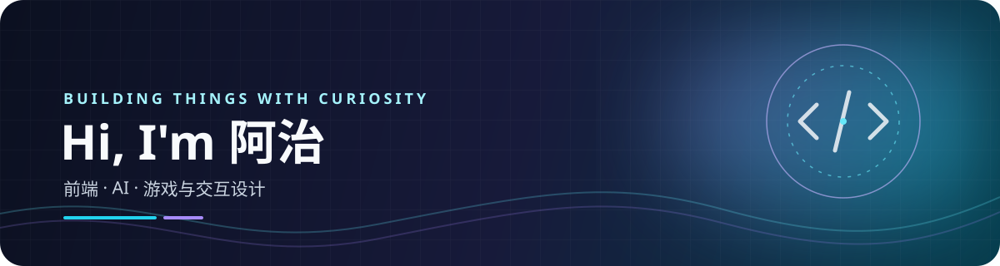

### 你好，我是六七，也可以叫我阿治 👋

 

---

## 关于我

- 🧩 喜欢把想法变成有用、好用的小产品
- 🎮 关注前端、游戏开发与交互设计
- 🧠 正在探索本地优先的 AI、知识管理与个人工具
- 🛠️ 常用 **TypeScript、Vue 3、Bun、Nuxt**，也会写 JavaScript

## 正在做的项目

| 项目 | 简介 | 技术 |
| --- | --- | --- |
| [✨ Awesome](https://github.com/xiaozhibro/awesome) | 本地优先的 AI 全家桶，包含平台底座、知识管理与游戏平台等模块 | Bun · TypeScript · Vue 3 |
| [📦 库克进销存](https://github.com/xiaozhibro/kuck-invoicing) | 面向小型门店的轻量进销存系统，覆盖采购、库存、销售与经营报表 | Nuxt 4 · SQLite |
| [🧮 算法练习](https://github.com/xiaozhibro/algorithm) | 刷题记录与算法练习 | JavaScript |

## 技术栈

## GitHub 数据

---

**感谢来访，欢迎交流与一起折腾！** 
保持好奇，持续构建。 ✨

